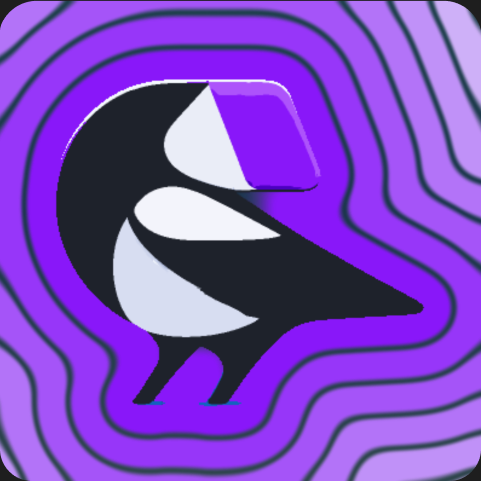
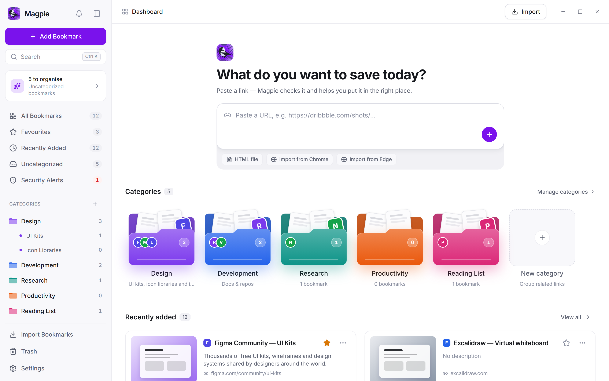
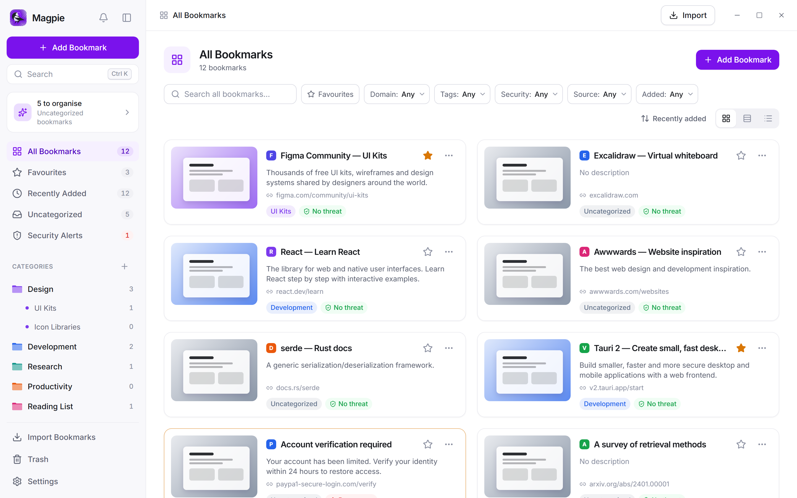
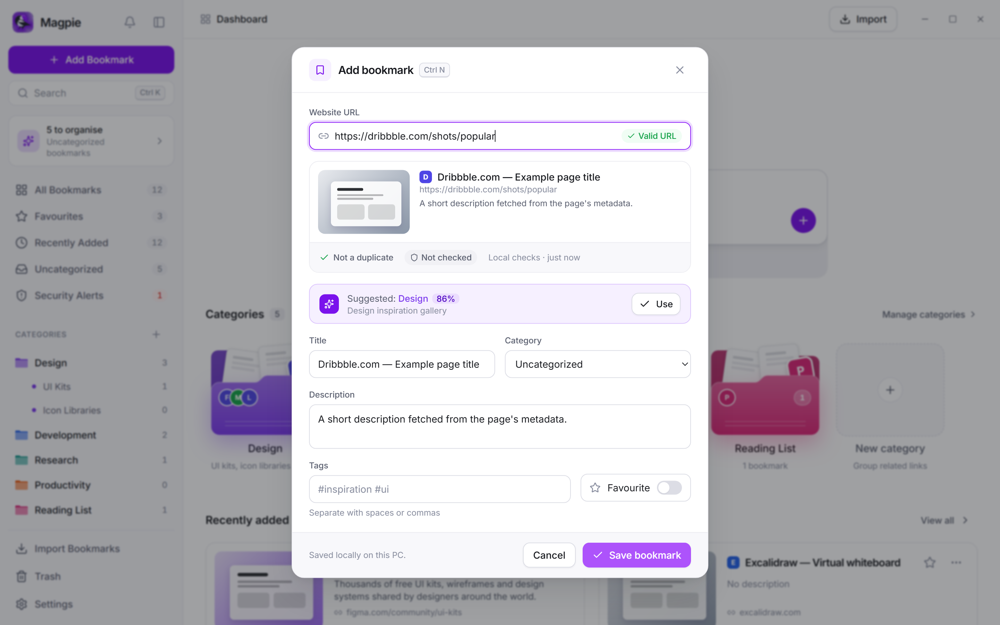
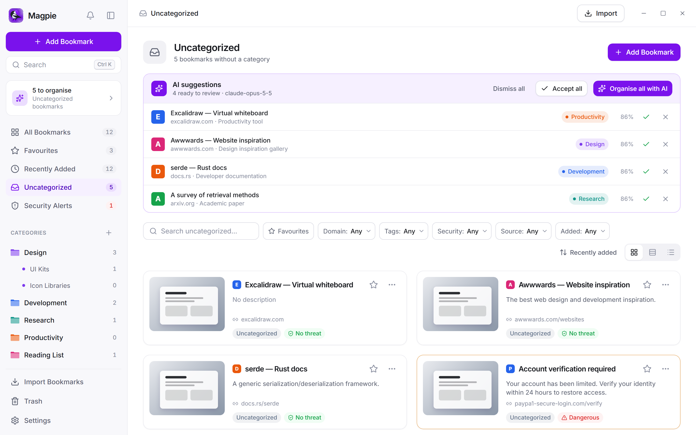
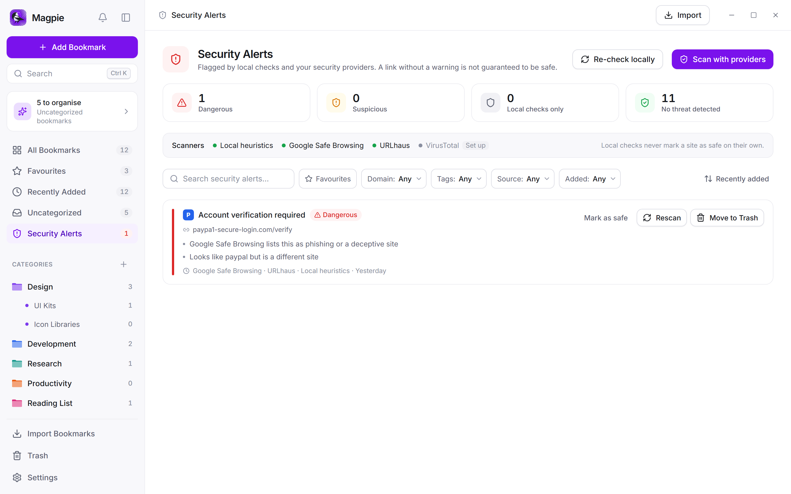
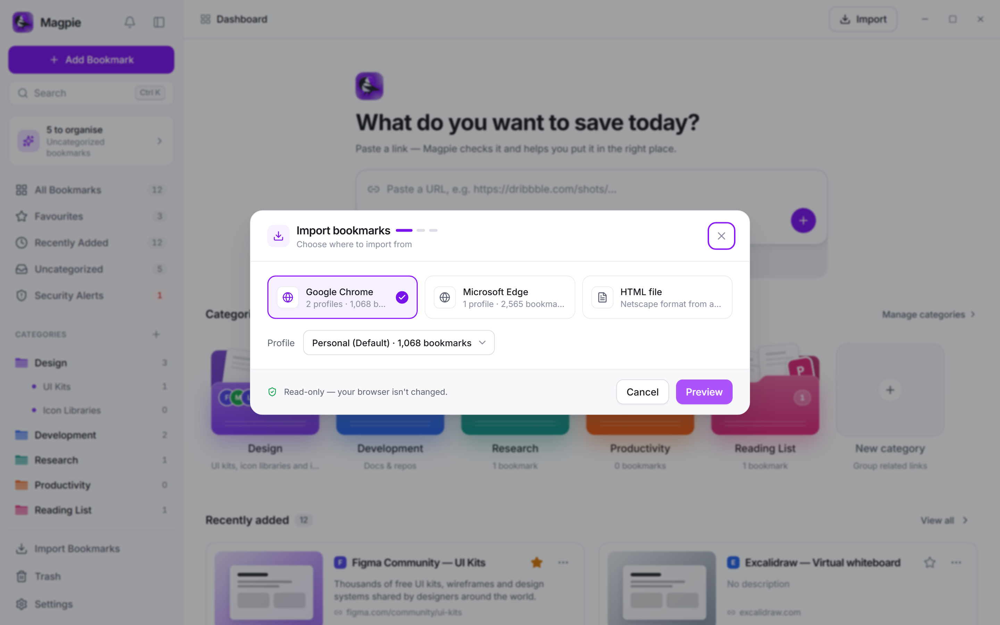
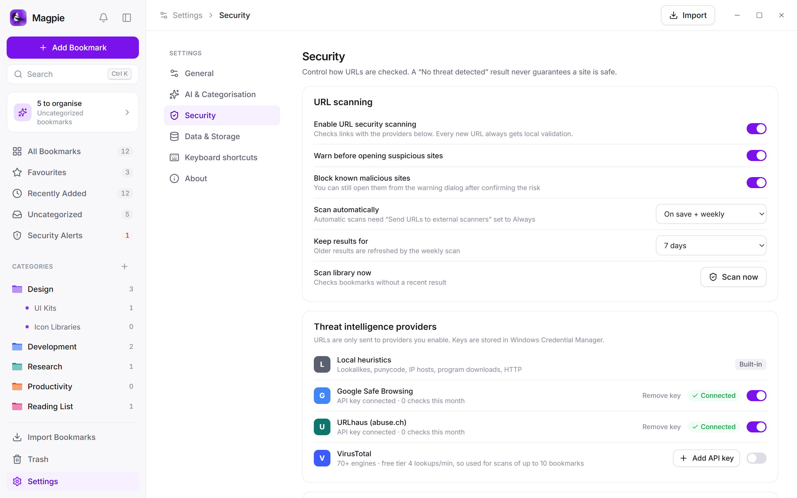

<div align="center">



# Magpie

**A calm, local-first bookmark manager for Windows.**
Bring in your Chrome and Edge bookmarks, organise them into colour-coded categories, find anything in milliseconds, and get warned about unsafe sites *before* you open them.

[](https://github.com/ShaikMoosa/Magpie/releases/latest)
[](https://github.com/ShaikMoosa/Magpie/actions/workflows/ci.yml)


[**Download**](https://github.com/ShaikMoosa/Magpie/releases/latest) · [Features](#features) · [Screenshots](#screenshots) · [Privacy & security](#privacy--security) · [Development](#development)



</div>

## Contents

- [Features](#features)
- [Screenshots](#screenshots)
- [Install](#install)
- [Getting started](#getting-started)
- [Keyboard shortcuts](#keyboard-shortcuts)
- [Privacy & security](#privacy--security)
- [Development](#development)
- [Project structure](#project-structure)
- [Roadmap](#roadmap)
- [Contributing](#contributing)

## Features

| | |
|---|---|
| 📥 **Import in one click** | Chrome and Edge profiles are detected automatically, or use any HTML bookmarks file. Preview first, keep folders as categories, and skip duplicates. Your browser is never changed. |
| 🗂️ **Organise your way** | Nested, colour-coded categories, favourites, tags, Trash, and card, compact or list views. |
| 🖼️ **Link previews** | Titles, descriptions, icons and preview images are fetched safely: private and local network addresses are never contacted, and only images are cached. |
| 🔎 **Fast search & filters** | Full-text search across titles, descriptions, URLs, categories and tags, plus domain, tag, security, source and date filters. Searching 10,000 bookmarks takes about 10 ms. |
| 🛡️ **Malicious-URL warnings** | Local checks catch look-alike domains, punycode, IP hosts, program downloads and insecure HTTP. Optional **Google Safe Browsing**, **URLhaus** and **VirusTotal** lookups. Known-dangerous sites are blocked before they open. |
| ✨ **AI categorisation (optional)** | Bring your own key for **OpenAI**, **Anthropic**, **Google Gemini** or any OpenAI-compatible endpoint (such as a local Ollama). Review suggestions or let Magpie file bookmarks automatically. |
| 💾 **Your data, your formats** | Export to JSON, HTML or CSV, with daily local backups and one-click restore. |
| 🪟 **Feels at home on Windows** | System tray, launch at startup, **Ctrl+Alt+B** quick add from anywhere, open in a private window, and accent colours. |

## Screenshots

<table>
  <tr>
    <td width="50%"><br /><sub><b>Library</b>: card, compact and list views with filters.</sub></td>
    <td width="50%"><br /><sub><b>Add bookmark</b>: preview, duplicate and security check, AI suggestion.</sub></td>
  </tr>
  <tr>
    <td><br /><sub><b>AI suggestions</b>: review, accept or dismiss in bulk.</sub></td>
    <td><br /><sub><b>Security alerts</b>: every result shows its source and time.</sub></td>
  </tr>
  <tr>
    <td><br /><sub><b>Import</b>: Chrome and Edge profiles detected automatically.</sub></td>
    <td><br /><sub><b>Settings</b>: providers, consent and privacy controls.</sub></td>
  </tr>
</table>

## Install

1. Download **`Magpie_<version>_x64-setup.exe`** from the [latest release](https://github.com/ShaikMoosa/Magpie/releases/latest). An `.msi` is there too if you prefer it.
2. Run it. It installs for your user account only and doesn't need administrator rights.
3. **Windows SmartScreen:** builds aren't code-signed yet, so Windows may say *"Windows protected your PC"*. Choose **More info → Run anyway**. Each release lists SHA-256 checksums so you can verify the download.

**Requirements:** Windows 10 (1803 or later) or Windows 11, 64-bit. Magpie uses the Microsoft Edge WebView2 runtime, which is built into Windows 11 and installed automatically on Windows 10 if missing.

To uninstall, use **Settings → Apps → Installed apps → Magpie**. Your library stays in `%APPDATA%\com.shaikmoosa.magpie` until you delete that folder.

## Getting started

1. **Import** on the welcome screen: pick Chrome, Edge or an HTML file, preview what's coming in, and import.
2. **Add** links with **Ctrl+N** or the box on the dashboard. Magpie fetches a preview and checks the link.
3. **Optional AI:** open **Settings → AI & Categorisation**, choose a provider, paste your key and *Test connection*. Then use **Organise all with AI** in *Uncategorized*.
4. **Optional scanners:** open **Settings → Security**, add a Google Safe Browsing, URLhaus or VirusTotal key, and choose whether URLs may be sent *each time*, *always* or *never*.
5. **Back up:** **Settings → Data & Storage** makes daily snapshots automatically and exports to JSON, HTML or CSV.

## Keyboard shortcuts

| Action | Shortcut |
|---|---|
| Add bookmark | <kbd>Ctrl</kbd> + <kbd>N</kbd> |
| Search | <kbd>Ctrl</kbd> + <kbd>K</kbd> or <kbd>Ctrl</kbd> + <kbd>F</kbd> |
| Import bookmarks | <kbd>Ctrl</kbd> + <kbd>I</kbd> |
| Open favourites | <kbd>Ctrl</kbd> + <kbd>Shift</kbd> + <kbd>F</kbd> |
| Open selected / in a private window | <kbd>Ctrl</kbd> + <kbd>Enter</kbd> / <kbd>Ctrl</kbd> + <kbd>Shift</kbd> + <kbd>N</kbd> |
| Copy URL | <kbd>Ctrl</kbd> + <kbd>Shift</kbd> + <kbd>C</kbd> |
| Edit / favourite / delete selected | <kbd>F2</kbd> / <kbd>Ctrl</kbd> + <kbd>D</kbd> / <kbd>Delete</kbd> |
| Select all / clear selection | <kbd>Ctrl</kbd> + <kbd>A</kbd> / <kbd>Esc</kbd> |
| Quick add from anywhere (tray mode) | <kbd>Ctrl</kbd> + <kbd>Alt</kbd> + <kbd>B</kbd> |

## Privacy & security

- **Local-first.** No account, no cloud, no telemetry. Everything lives in a SQLite database on your PC.
- **Keys stay in Windows Credential Manager.** They're never written to the database, sent to the interface or included in error messages.
- **You choose what leaves your PC.** AI providers receive only a bookmark's URL (without query string or fragment), title, description and your category names. Security scanners receive URLs only after you consent, with login details, `#fragments` and (optionally) tracking or token parameters removed. Sites you trust are never sent.
- **"No threat detected" is never a guarantee.** A failed or unavailable check is never reported as safe.
- **Safe previews.** Preview fetching refuses private and local network addresses (including after redirects and DNS lookups), caps download sizes, and only caches images. The app runs under a strict Content Security Policy and Tauri capabilities.

Found a vulnerability? Please report it privately. See [SECURITY.md](SECURITY.md).

## Development

**Prerequisites:** Windows 10/11, [Node.js](https://nodejs.org) 20+, [Rust](https://rustup.rs), and the [Tauri prerequisites](https://v2.tauri.app/start/prerequisites/) (Visual Studio C++ build tools, WebView2).

The Rust toolchain is pinned to **1.98.0** in [`rust-toolchain.toml`](rust-toolchain.toml) and rustup installs it automatically. Newer Cargo versions use a build-folder layout that some antivirus tools, such as Kaspersky, quarantine.

```powershell
npm install
npm run tauri dev       # run the app with hot reload
npm run tauri build     # build the NSIS and MSI installers
```

| Command | What it does |
|---|---|
| `npm run dev` | Run the UI in a browser with a mock backend and sample data (no Rust needed) |
| `npm run typecheck` | TypeScript type-check |
| `npm test` | Frontend unit tests (Vitest) |
| `cargo test` in `crates/magpie-core` | Core library tests (database, import, security, AI parsing, backups…) |
| `cargo test --release --test perf -- --ignored --nocapture` in `crates/magpie-core` | Large-library benchmark (set `MAGPIE_PERF_N=100000` for the stress test) |
| `cargo test` in `src-tauri` | App crate tests |

Browser preview options: `?empty` starts with an empty library, `?big` adds 5,000 bookmarks, and `?shot=<name>` opens a screen used for the screenshots in this README.

### Releasing

Bump the version in `src-tauri/tauri.conf.json`, `src-tauri/Cargo.toml` and `package.json`, then push a tag:

```powershell
git tag v0.2.0
git push origin v0.2.0
```

The [Release workflow](.github/workflows/release.yml) builds the installers and publishes them, with checksums, to a draft GitHub release for you to review and publish.

## Project structure

```
crates/magpie-core/   Rust core: SQLite + FTS5, bookmarks, categories, import, previews,
                      URL security and scanners, AI providers, export and backups (no UI code)
src-tauri/            Tauri app: commands, background workers, tray, key storage
src/                  React + TypeScript UI (Tailwind, Radix, TanStack Query, Zustand)
src/dev/              Mock backend for running the UI in a browser
design/               Logo and design assets (Figma: "Bookmark Manager - version 2")
docs/screenshots/     README screenshots
```

## Roadmap

- [x] Core library, browser import, previews, search, local URL checks
- [x] AI categorisation, external scanners, export, backups and restore
- [x] Windows integration: tray, startup, quick add, private windows
- [ ] Code-signed installers and automatic updates
- [ ] Smart collections and advanced tag management
- [ ] Browser extension
- [ ] Optional sync

## Contributing

Issues and pull requests are welcome. Please open an issue first for larger changes. Before submitting, run `npm run typecheck` and the Rust tests above; CI runs the same checks and builds the installer on every pull request.

---

<sub>Magpie is built with [Tauri](https://tauri.app), [React](https://react.dev), [SQLite](https://sqlite.org) and [Lucide](https://lucide.dev) icons. Inter is the interface typeface.</sub>
